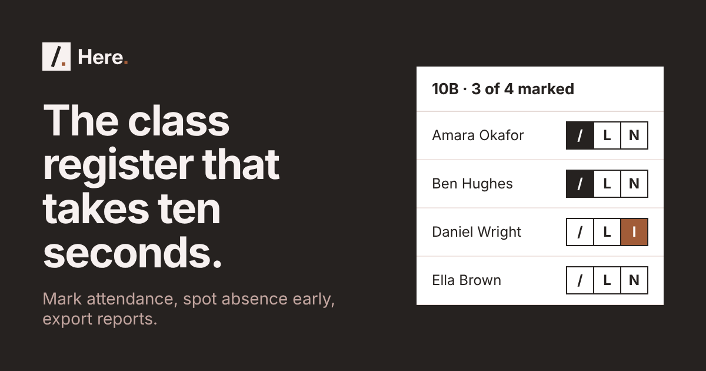

# Here.

The class register that takes ten seconds. Teachers and tutors mark attendance on their phone, see who is slipping below 90% and hand over reports as a spreadsheet.

**Live:** https://here.guilduk.com. Choose *Try it now* to open a private demo with a full sample class. No sign-up needed.



It began as my university dissertation project. I rebuilt it with private accounts, a phone-first register, a security review, tests and a brand of its own.

## What it does

| Area | Features |
| --- | --- |
| Today | A card for each class showing how many are marked, with one button to take or finish the register. A list of students below 90% and absences with no reason, each linking to the place to fix it. |
| Register | Marks from a paper register: `/` present, `L` late, `N` absent. Absences take a reason (`I` illness, `M` medical, `H` holiday). Notes, "mark the rest present" with undo, earlier days, and keyboard shortcuts on a computer. Every tap saves. |
| Month view | Every mark for the month in a grid. Tap a square to change it, point at it for details, or tap a date to open that day. |
| Search and actions | Press `Ctrl K` (or `Cmd K`), or the search box in the menu, to reach any student, class or page, or to import, report, play music or switch space, from anywhere. |
| Students | Paste a whole class from a spreadsheet, or import from Zoho. Take or upload a photo, then crop, zoom and rotate it, with a consent tick for each student. Profiles show attendance by day of the week and reasons for absence. |
| Photo grid | Take the register by tapping faces instead of names. |
| Points | Behaviour points in one tap, for one student or the whole class, with your own list of behaviours, an undo, top points and a weekly class goal with a reward. |
| Celebrations | Every day this week, on time for the last 10 sessions, and most improved attendance. Pupils are never ranked by attendance itself, because illness is not their fault. |
| Tasks | A group can be a class or a team. Set tasks, mark each person done, late or not done and their share of the work, then see completion, punctuality, workload balance and weekly trends, with a flag when someone misses several in a row. |
| Toolkit | Pick a name (only from people marked present today, never the same person twice in a row), make random groups, and a classroom timer. |
| Reports | Date presets, a weekly trend chart, a table for each student, CSV downloads and a print layout. Days off such as half terms are left out of every percentage. |
| Zoho CRM | Connect your own Zoho, import students from Contacts (filtered by tag, already linked), and send attendance back as a note, as fields Zoho can report on, or as a check-in task. Check-ins are suggested after three absences in a row or attendance under 90%, and nothing is created until you approve it. Shown on Today, Students, each class and each profile. A built-in sample CRM lets anyone try it in the demo. |
| Apps | Message a parent about an absence on WhatsApp or by email, and a music player for YouTube or Spotify that keeps playing between pages, shrinks to a button and pops out into a floating window. Connection keys are encrypted and private to each account. |
| Sandbox | A second space beside your real register, switched with tabs like sheets in a spreadsheet, with a sliding transition. It starts with a sample class, and its tools fill in a day, simulate a bad week, add students, reset or empty it. Nothing in it reaches real classes. |
| Accounts | Try it without signing up: a private guest demo that deletes itself after 24 hours. Or sign in with Google or an email code. Every account is private. Download or delete all your data from Settings. |
| Everywhere | Phone and desktop layouts, light and dark themes, installable to the home screen, offline notice, keyboard and screen reader support. |

## What this project shows

| Skill | Where to look |
| --- | --- |
| Full-stack web development | Next.js App Router pages and route handlers, Postgres through Drizzle ORM (`app/`, `lib/`) |
| Secure multi-user design | Session checks in middleware and in every route, data scoped to each account, signed guest sessions for the demo, a sandbox isolated by its own owner id, server-side validation, safe CSV export (`SECURITY.md`) |
| Testing and CI | Unit tests for the attendance maths, input checks, guest sessions, encryption, OAuth state and CRM rules, run by GitHub Actions on every pull request (`tests/`, `.github/workflows/`) |
| Third-party integration | Per-user OAuth with Zoho, keys encrypted with AES-256-GCM, signed one-time state, region checks, token refresh and revoke, and everything sent to Zoho built on the server from stored marks (`lib/providers/zoho.js`, `lib/connections.js`, `lib/crm.js`) |
| Product and UX thinking | Built around a teacher's real routine: one button per class, codes from paper registers, a first-run guide, empty and error states (`docs/DECISIONS.md`) |
| Accessibility | Labels on every control, visible focus, skip link, 44px tap targets, colours that work in greyscale, reduced motion respected |
| Design systems | A small brand and token set applied across every screen (`docs/DESIGN.md`, `app/globals.css`) |
| Performance on phones | Optimistic updates, no heavy UI library, static icons and share image |
| Data and reporting | Persistent absence calculation, weekly trends, task contribution analytics, CSV export, GDPR-style export and delete |
| Handling personal data | Photo consent per student, photos resized and stripped of location data in the browser, served only to the owning account |
| Documentation | Architecture, decisions, design guide, security policy and contribution notes (`docs/`) |

## Built with

Next.js 14, React 18, Kinde, Neon Postgres, Drizzle ORM, plain CSS, Vercel and GitHub Actions.

Read `docs/ARCHITECTURE.md` for how the parts fit together and `docs/DECISIONS.md` for why.

## Run it locally

1. Install Node.js 20 or newer.
2. Create a free Kinde app and a free Neon database.
3. In Kinde, add `http://localhost:3000/api/auth/kinde_callback` to the allowed callback URLs and `http://localhost:3000/signed-out` to the allowed logout URLs.
4. Copy `.env.example` to `.env.local` and fill in your values.
5. Run the SQL files in `drizzle/` in order in the Neon SQL editor.
6. Optional, for Zoho: register a server-based client at api-console.zoho.eu with the redirect URL `http://localhost:3000/api/connect/zoho/callback`, and put its Client ID and Secret in `.env.local` with a `CONNECTIONS_KEY` (`openssl rand -base64 32`).
7. Run `npm install`, then `npm run dev`, then open http://localhost:3000.

## Tests

```bash
npm test
```

The tests cover percentages, days off, week and school year boundaries, leap years, register codes, CSV escaping, every input check, guest and sandbox sessions, encryption and tampering, the OAuth state check, trusted Zoho addresses, media links, and the CRM rules for check-ins, fields, tasks and imports.

## Ideas for later

- Organisations: several tutors sharing classes and one Zoho connection, with roles and an audit log.
- Morning and afternoon sessions, since schools in England take two registers a day.
- Import from a school information system.

## Licence

MIT. Built by Michael Ijisonuwe.


